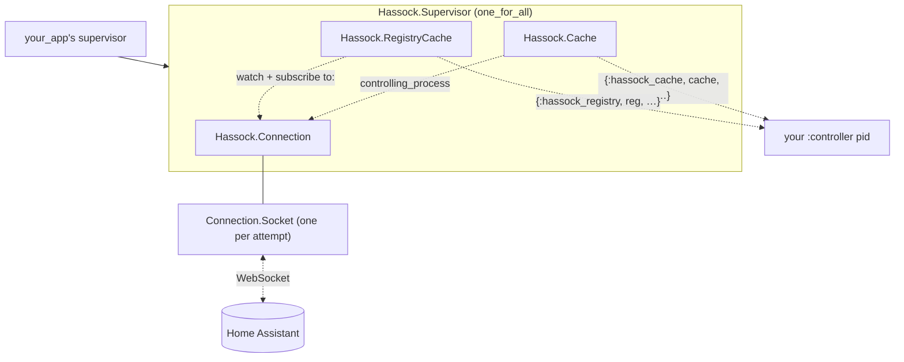

# Hassock

Home Assistant WebSocket client for Elixir.

Hassock connects to a Home Assistant instance over its WebSocket API,
authenticates, and lets your application subscribe to entity state changes,
call services, send any other WebSocket command, read the floor, area,
device, entity and label registries, and (optionally) keep in-memory ETS
caches of entity states and of the registries.

The connection starts in the background and keeps itself up: it retries with
exponential backoff while Home Assistant is down, detects dead links with a
keepalive ping, and restores your subscriptions after every reconnect.

It follows the controlling-process pattern from `:gen_tcp` /
`Circuits.UART`: the process that calls `start_link/1` becomes the recipient
of async messages, and ownership can be handed off explicitly with
`controlling_process/2`.

Requires Home Assistant ≥ 2022.4 if you use `Hassock.Cache`
(`subscribe_entities` was added in that release).

## Installation

```elixir
def deps do
  [
    {:hassock, "~> 0.3.0"}
  ]
end
```

## Usage

### Bare connection — for targeted subscriptions

Subscribe only to the entities (or events) you care about; do everything else
manually.

```elixir
config = %Hassock.Config{
  url: "http://homeassistant.local:8123",
  token: System.fetch_env!("HASSOCK_TOKEN")
}

{:ok, conn} = Hassock.connect(config: config)

receive do
  {:hassock, ^conn, :connected} -> :ok
end

{:ok, _sub_id} = Hassock.subscribe_entities(conn, ["light.kitchen"])

# In your handle_info/2 (or a receive loop):
#
# {:hassock, ^conn, {:event, {:entities, %{added: a, changed: c, removed: r}}}} -> ...
# {:hassock, ^conn, {:disconnected, reason}}                                    -> ...
# {:hassock, ^conn, :connected}                                                 -> ...
```

`connect/1` returns before the connection is up; commands sent before
`:connected` return `{:error, :not_connected}`. `:connected` arrives again
after every reconnect. Subscriptions are restored automatically and keep
their ids, so don't resubscribe on `:connected` (a restored
`subscribe_entities` starts with a fresh snapshot in `added`). If HA refuses
to restore one, you get `{:hassock, conn, {:subscription_lost, id, error}}`
and the subscription is dropped.

Events go to the controlling process. Pass `to: pid` to `subscribe_events/3`
or `subscribe_entities/3` to send a subscription's events elsewhere; it is
cancelled when that process exits.

> **Note:** these `changed` entries are *diffs*, not full entity states —
> each one describes only the fields that changed (state, specific attribute
> additions, specific attribute removals). It's up to your code to apply
> them against prior state if you need the complete picture. The `added`
> map (initial snapshot and any newly-created entities) does carry full
> `%Hassock.EntityState{}` structs. If you'd rather get fully-materialized
> states and old-vs-new comparisons out of the box, use `Hassock.Cache`.

To call a service:

```elixir
Hassock.call_service(conn, %Hassock.ServiceCall{
  domain: "light",
  service: "toggle",
  target: %{entity_id: "light.kitchen"}
})
```

For services that return data, set `return_response: true`; the data is
under `"response"` in the result:

```elixir
{:ok, %{"response" => forecasts}} =
  Hassock.call_service(conn, %Hassock.ServiceCall{
    domain: "weather",
    service: "get_forecasts",
    target: %{entity_id: "weather.home"},
    service_data: %{type: "daily"},
    return_response: true
  })
```

### Any other command

`Hassock.command/4` sends any WebSocket command and waits for its result:

```elixir
{:ok, config} = Hassock.command(conn, "get_config")
{:ok, entry} =
  Hassock.command(conn, "config/entity_registry/get", %{entity_id: "light.kitchen"}, timeout: 5_000)
```

It returns `{:ok, result}`, `{:error, %{"code" => _, "message" => _}}` for an
HA error, or `{:error, :not_connected | :disconnected | :timeout}`.

### Registries

`Hassock.Registries` lists the floor, area, device, entity and label
registries as structs (`Hassock.Floor`, `Hassock.Area`, `Hassock.Device`,
`Hassock.EntityEntry`, `Hassock.Label`):

```elixir
{:ok, areas} = Hassock.Registries.list_areas(conn)
{:ok, entries} = Hassock.Registries.list_entities(conn)
```

Subscribing to a registry's update event gives typed events:

```elixir
{:ok, _} = Hassock.subscribe_events(conn, "area_registry_updated")
# {:hassock, ^conn, {:event, {:registry_updated, :area, :create | :update | :remove, area_id}}}
```

`Hassock.RegistryCache` keeps all five registries in ETS: it lists them on
every `:connected`, re-lists one (debounced) when its update event arrives,
and sends `{:hassock_registry, cache, :ready}` and
`{:hassock_registry, cache, {:changed, kind}}` to its controller. It doesn't
take ownership of the connection, so it runs beside `Hassock.Cache`:

```elixir
{:ok, reg} = Hassock.RegistryCache.start_link(connection: conn)

receive do
  {:hassock_registry, ^reg, :ready} -> :ok
end

Hassock.RegistryCache.list(reg, :floor)
Hassock.RegistryCache.get(reg, :area, "kitchen")
```

### With an entity cache — for "show me everything" use cases

`Hassock.Cache` subscribes to every entity, holds the world in ETS, and emits
high-level change messages. Reads are direct ETS lookups — no GenServer
roundtrip.

```elixir
{:ok, conn} = Hassock.connect(config: config)
{:ok, cache} = Hassock.Cache.start_link(connection: conn)

receive do
  {:hassock_cache, ^cache, :ready} -> :ok
end

Hassock.cached_state(cache, "light.kitchen")
Hassock.cached_domain(cache, "light")
```

Cache messages:

  * `{:hassock_cache, cache, :ready}` — after the initial snapshot loads, and
    again after each reconnect once the table is back in sync
  * `{:hassock_cache, cache, {:changes, %{added: _, changed: _, removed: _}}}` —
    per delta, and before the post-reconnect `:ready` with what changed
    during the outage (removed entities are deleted from the table)
  * `{:hassock_cache, cache, :disconnected}` — on socket loss (ETS retained)

> **Note on ownership:** `Hassock.Cache.start_link/1` *transfers ownership* of
> the connection to the cache. After it returns, the cache receives all
> `{:hassock, conn, …}` messages — your code talks to the cache, not the
> connection, for async events. (Synchronous calls like `call_service/2` and
> `get_states/1` still work directly on `conn`.)

### Connection robustness

All of these are fields of `%Hassock.Config{}`:

  * **Backoff** — reconnects wait `backoff_initial` ms (default 1 s),
    doubling to `backoff_max` (default 30 s), with jitter. The count resets
    once a connection has stayed up for `backoff_max`, so a server that
    accepts and then drops connections is still backed off.
    `{:disconnected, reason}` is sent once per outage, not once per attempt.
    `Hassock.status(conn)` reports `%{status: _, attempt: _, next_retry_in: ms}`.
  * **Connect timeout** — an attempt that hasn't authenticated within
    `connect_timeout` ms (default 15 s) is abandoned and retried.
  * **Keepalive** — while connected, a `ping` every `ping_interval` ms
    (default 30 s, `nil` to disable); no `pong` within `ping_timeout`
    (default 10 s) and the connection is re-made, with
    `{:disconnected, :ping_timeout}`.
  * **Bad token** — on `auth_invalid` the controller gets
    `{:auth_failed, reason}` (a `Hassock.Cache` passes it on as
    `{:hassock_cache, cache, {:auth_failed, reason}}`) and the connection
    stops retrying, since Home Assistant bans IPs after repeated failed
    logins.

Other processes can get the lifecycle messages (`:connected`,
`{:disconnected, _}`, `{:auth_failed, _}`) with `Hassock.watch(conn)`, until
`Hassock.unwatch(conn)`. `inspect/1` of a `%Hassock.Config{}` leaves out the
token and `ssl_options`.

### TLS

For `https://` URLs the server certificate is verified against the system
CA store (`:public_key.cacerts_get/0`). If the system has no CA store (common
on embedded systems such as Nerves), Hassock logs a warning and connects
**without** verification; set `ssl_options` to avoid that, for example with
the [`castore`](https://hex.pm/packages/castore) package, or with the CA of a
self-signed certificate:

```elixir
%Hassock.Config{
  url: "https://homeassistant.local:8123",
  token: token,
  ssl_options: [
    verify: :verify_peer,
    cacertfile: CAStore.file_path(),  # or "/data/ha-ca.pem"
    customize_hostname_check: [
      match_fun: :public_key.pkix_verify_hostname_match_fun(:https)
    ]
  ]
}
```

`ssl_options` replaces the defaults, so include `customize_hostname_check`
if the certificate uses a wildcard name. `ssl_options: [verify: :verify_none]`
turns verification off explicitly. Plain `http://` sends the token
unencrypted.

### Hand off message reception

```elixir
:ok = Hassock.controlling_process(conn, other_pid)
:ok = Hassock.Cache.controlling_process(cache, other_pid)
```

Only the current controller may transfer ownership.

### Convenience supervisor

If you want a single child spec for your application's supervision tree:

```elixir
{Hassock.Supervisor,
 config: config,
 cache: true,
 registries: true,
 controller: my_handler_pid}
```

This wires `Hassock.Connection` + `Hassock.Cache` + `Hassock.RegistryCache`
under a `one_for_all` supervisor and delivers cache and registry events to
`controller` (default: caller).

## Architecture

With `Hassock.Supervisor` (cache and registries enabled), the supervision
tree looks like:



Solid edges are supervision links; dashed edges are message / ownership flow.

  * **`one_for_all`** — if any child crashes, all restart from a clean
    slate. This avoids the restart-time edge cases of reclaiming the
    connection's controlling process and orphaning the old HA-side
    `subscribe_entities` subscription; on restart, a fresh auth handshake
    and fresh subscription give a pristine starting point.
  * **Ownership flow** — `Cache.start_link/1` hands the connection to the
    new cache (`Connection.controlling_process(conn, cache)`, called from the
    caller's process), so every `{:hassock, conn, …}` event lands in the
    cache, not the caller. Under the supervisor the connection starts
    without a controller until the cache claims it.
    The cache then emits higher-level `{:hassock_cache, cache, …}` messages
    to its own controller (the `:controller` pid, default: caller).
  * **Connection and socket** — `Hassock.Connection` is a GenServer that
    owns one short-lived WebSocket process per connection attempt. It
    schedules reconnects itself, so it keeps answering calls (with
    `{:error, :not_connected}`) during an outage instead of blocking.
  * **Registry cache** — `RegistryCache` doesn't take ownership: it
    `watch`es the connection for `:connected` and subscribes with
    `to: self()`, so registry events go to it and not to the controller.
    Its lists run in a linked task, so it stays responsive while a large
    registry loads.
  * **Without the cache** — the Connection is a direct child of your
    supervisor (or unsupervised), and the caller receives
    `{:hassock, conn, …}` events directly.
  * **Synchronous commands** (`call_service/3`, `get_states/1`,
    `subscribe_entities/3`, `command/4`, …) always go directly to the Connection pid —
    they don't flow through the controlling-process channel.

## Development

```bash
mix deps.get
mix test
```

The unit tests run against a scriptable fake Home Assistant
(`test/support/fake_ha.ex`). The registry fixtures in
`test/fixtures/registries/` were recorded from Home Assistant 2026.10 and
scrubbed of names and ids.

Integration tests are tagged `:integration` and skipped by default. To run
them against a live Home Assistant:

```bash
HASSOCK_URL=http://homeassistant.local:8123 \
HASSOCK_TOKEN=... \
HASSOCK_LIGHT_ENTITY=light.your_light \
mix test --include integration
```

`HASSOCK_LIGHT_ENTITY` is optional — without it, light-toggle assertions
auto-discover the first available `light.*` entity or skip.
